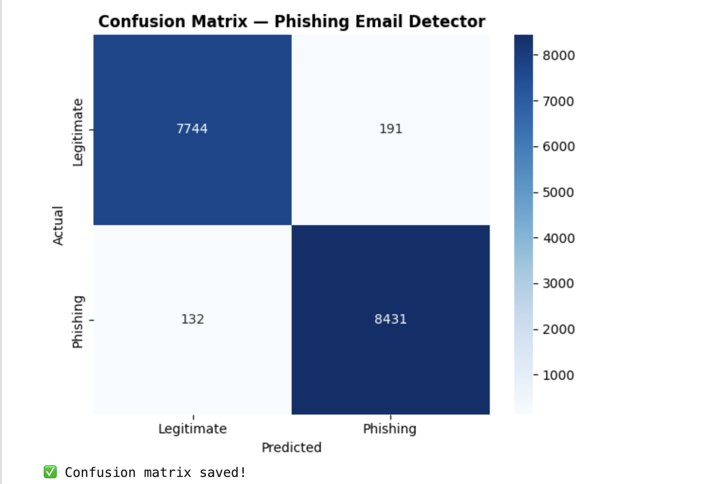

# Phishing Email Analyzer — ML Email Classification

Built by Astha Patel | M.S. Information Technology, Arizona State University

> **The short version:** this model is 98.04% accurate on 16,498 test emails. On five realistic workplace messages, it got 3 right. It missed an email from a hacked coworker's account and flagged a normal vendor invoice as phishing. Both results are below, along with why they differ.

---

## Why I Built This

Email is still one of the most common ways attackers get in. I wanted to build a classifier on a large, real dataset and understand what actually separates a phishing email from a legitimate one at the text level. Then I wanted to find where that breaks.

---

## What It Does

The analyzer reads an email's text (subject + body) and classifies it as phishing or legitimate, with a confidence score. It converts the text into TF-IDF features and runs them through a Logistic Regression classifier.

- `phishing_analyzer.py`: trains the model, prints test results, saves charts and the model
- `detect.py`: paste any email and get an instant verdict, or run `--real-world`
- `phishing_email_analyzer.ipynb`: the same pipeline step by step ([open in Colab](https://colab.research.google.com/github/astha2310/phishing-email-analyzer/blob/main/phishing_email_analyzer.ipynb))

---

## The Data

The [Phishing Email Dataset](https://www.kaggle.com/datasets/naserabdullahalam/phishing-email-dataset) on Kaggle (Naser Abdullah Alam). It combines several public email corpora (Enron, Ling, CEAS, Nazario, Nigerian fraud and SpamAssassin) into one file, `phishing_email.csv`, with two columns: `text_combined` and `label` (1 = phishing).

| | Emails |
|---|---|
| Phishing | 42,891 |
| Legitimate | 39,595 |
| **Total** | **82,486** (65,988 train / 16,498 test) |

The dataset isn't included in this repo because of its size. Download it from Kaggle and put `phishing_email.csv` in this folder.

---

## Results (test set)

| Metric | Value |
|---|---|
| Accuracy | 98.04% |
| Precision | 0.98 |
| Recall | 0.98 |
| F1 Score | 0.98 |



---

## Real-World Testing: Where 98% Breaks

In November 2026 I ran a phishing-awareness experiment with realistic workplace messages from a fictional company. I ran the same messages through this model, before seeing any participant's answers. Try it yourself with `python3 detect.py --real-world`:

| Message | Really | Model says | Confidence |
|---|---|---|---|
| "Your password expires today, verify now" | Phishing | Phishing | 76.9% |
| Fake delivery text with a link | Phishing | Phishing | 77.3% |
| Coworker's real account: "approve this invoice, zip password 1234" | Phishing | **Legitimate** | 86.2% |
| IT maintenance notice, no link, no action needed | Legitimate | Legitimate | 96.4% |
| Monthly invoice from a known vendor, no link | Legitimate | **Phishing** | 62.6% |

**3 out of 5.** And the participants in my experiment made the same mistake on the coworker email: more than half trusted it.

**Why it misses the hacked-coworker email:** the model only sees words. That email has no "urgent", no "verify", no "suspended". It reads like normal work. What makes it dangerous is the context: Marketing doesn't send invoices, the "RE:" has no earlier thread, and a password-protected .zip slips past virus scanners. None of that is in the text.

**Why it flags the real invoice:** words like *invoice*, *account*, *sign in* and *$249* show up constantly in phishing. And most of the legitimate emails in the training data are older corporate mail (the Enron corpus is from the early 2000s), so a modern billing email looks more like phishing than like the "normal" email the model learned from.

**Why this matters in a SOC:** text-based detection catches the loud, obvious phishing. Compromised internal accounts need different signals: new inbox forwarding rules, unusual sign-ins, password-protected archives sent internally. Those come from logs, not from the email body.

---

## How It Works

TF-IDF turns each email into a vector of word weights. Words that are common in phishing but rare in legitimate email (like "verify", "suspended" and "click") get high weight, while everyday words get little. Logistic Regression learns from those weights and outputs a probability, so a 0.97 phishing score can be treated differently from a 0.61.

---

## Tech Stack

Python 3, scikit-learn, pandas, matplotlib, seaborn, joblib

---

## How to Run It

```bash
git clone https://github.com/astha2310/phishing-email-analyzer.git
cd phishing-email-analyzer

pip3 install -r requirements.txt

# download phishing_email.csv from Kaggle into this folder, then:
python3 phishing_analyzer.py        # train + evaluate (about 1 minute)
python3 detect.py                   # paste emails to check them
python3 detect.py --real-world      # the real-world check above
```

---

## What I Learned

1. **Phishing has a vocabulary.** Words like "verify", "urgent", "suspended" and "click" show up far more often in phishing emails, and a simple model gets very far on that alone.
2. **The most dangerous phishing doesn't use that vocabulary.** An email from a real but compromised account can look completely normal. Content filters alone won't catch it.
3. **The "legitimate" examples matter as much as the phishing ones.** If normal email in your training data is decades old, normal email today can look suspicious.
4. **In security, the trade-off between misses and false alarms is a choice.** A missed phishing email is usually worse than a false alarm, so the classification threshold should be tuned for that. It's on my list below.

---

## What's Next

- Add modern legitimate email (billing, SaaS notifications, MFA and IT notices) to reduce false alarms
- Tune the decision threshold for recall and report precision/recall at that threshold
- Header analysis (SPF, DKIM, DMARC) to catch spoofed senders
- URL extraction, with links scored by my [PhishGuard](https://github.com/astha2310/phishguard) URL model
- Gmail integration to classify incoming email automatically

---

Astha Patel | github.com/astha2310 | linkedin.com/in/asthap23
